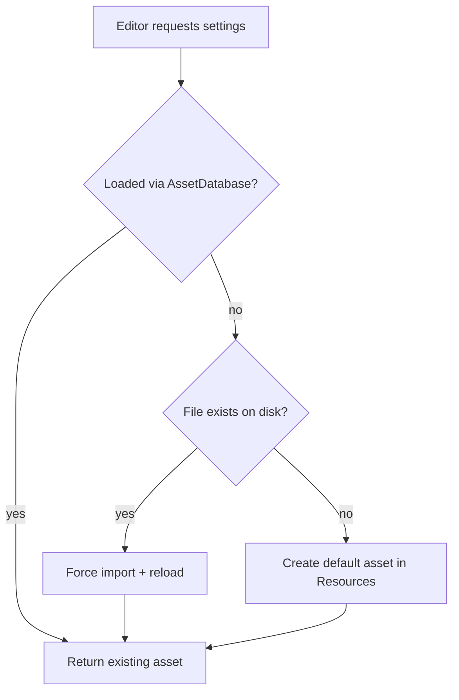

# AceLand Project Setting
A tiny base layer that turns a `ScriptableObject` into a protected, runtime-loadable project settings asset.

## In One Line
Type your settings once, edit them only where I say.

## Overview
`AceLand.ProjectSetting` is the foundation other AceLand packages build their settings on. You declare a
strongly-typed settings class by deriving from `ProjectSettings<T>`; the package then takes care of the
tedious parts: it **auto-creates a single asset under `Assets/Resources`**, exposes it to a custom
**Project Settings window**, and **locks the asset in the Inspector** so nobody edits it by accident.

Because the asset lives in `Resources`, the exact same values you set in the Editor are available at
runtime through a plain `Resources.Load` — no build steps, no manual wiring.

The package also ships a small `BuildLevel` enum used across AceLand packages to gate logging and features
per build type (Editor / Development / Production).

## Package Info
| |                                                                                                                      |
| --- |----------------------------------------------------------------------------------------------------------------------|
| display name | AceLand Project Setting                                                                                              |
| package name | com.aceland.projectsetting                                                                                           |
| latest version | 1.0.1                                                                                                                |
| namespace | AceLand.ProjectSetting                                                                                               |
| git repository | [https://github.com/parsue/com.aceland.projectsetting.git](https://github.com/parsue/com.aceland.projectsetting.git) |
| unity | 2022.3 or newer                                                                                                      |
| dependencies | none                                                                                                                 |

---

## Why Use It
- **One place to type, one place to edit.** Declare fields once; the asset, the settings window and the
  Inspector lock all follow automatically.
- **Runtime-ready by design.** The asset lives under `Resources`, so your Editor values are exactly what
  ships and what loads at runtime.
- **Accident-proof.** The generated asset is read-only in the Inspector — values can only be changed from
  the dedicated Project Settings window.
- **Source-control friendly.** Existing settings are never silently reset when a teammate pulls the project
  for the first time (see [How It Works](#how-it-works)).
- **Consistent logging gates.** A shared `BuildLevel` enum lets every package decide what runs in Editor,
  Development and Production with the same vocabulary.

---

## How It Works
A settings type derives from `ProjectSettings<T>`. The first time the Editor needs it, the base class:

1. Looks for `Assets/Resources/<TypeName>.asset` through the `AssetDatabase`.
2. If it is on disk but not yet imported (a fresh clone / first pull), it force-imports and reuses it.
3. Only if it genuinely does not exist does it create a new default asset.

That second step is the important one: it guarantees a teammate's existing, checked-in settings are
**never overwritten by a fresh default** the first time they open the project.



At runtime the same asset is fetched with `Resources.Load<T>("<TypeName>")`, so what you see in the Editor
is exactly what your build uses.

---

## Quick Start

### 1. Declare a settings type
Derive from `ProjectSettings<T>` and add whatever serialized fields you need. Keep the fields private and
expose read-only properties — the values are meant to be edited only from the settings window.



```csharp
using AceLand.ProjectSetting;
using UnityEngine;

// The asset will be created at: Assets/Resources/MyGameSettings.asset
public class MyGameSettings : ProjectSettings<MyGameSettings>
{
    [SerializeField] private string gameName = "My Game";
    [SerializeField, Min(0)] private int startingLives = 3;
    [SerializeField] private BuildLevel loggingLevel = BuildLevel.Development;

    public string GameName => gameName;
    public int StartingLives => startingLives;
    public bool PrintLogging => loggingLevel.IsAcceptedLevel();
}
```



```csharp
using UnityEngine;

public class Bootstrap : MonoBehaviour
{
    private void Awake()
    {
        // Loaded from Assets/Resources/MyGameSettings.asset
        var settings = Resources.Load<MyGameSettings>(nameof(MyGameSettings));
        Debug.Log($"Booting {settings.GameName} with {settings.StartingLives} lives");
    }
}
```




The asset file name always matches the type name. `MyGameSettings` becomes
`Assets/Resources/MyGameSettings.asset`, so `Resources.Load<MyGameSettings>("MyGameSettings")` always works.


### 2. Add a Project Settings window (Editor)
Expose the asset in **Edit ▸ Project Settings** by deriving from `AceLandSettingsProvider`. It already
handles undo/redo and dirtying — a minimal provider just needs to load the settings and draw them.

```csharp
using AceLand.ProjectSetting.Editor;
using UnityEditor;
using UnityEngine.UIElements;

public class MyGameSettingsProvider : AceLandSettingsProvider
{
    public const string SETTINGS_NAME = "Project/My Game";

    private MyGameSettingsProvider(string path, SettingsScope scope = SettingsScope.Project)
        : base(path, scope) { }

    public override void OnActivate(string searchContext, VisualElement rootElement)
    {
        base.OnActivate(searchContext, rootElement);
        Settings = MyGameSettings.GetSerializedSettings();
    }

    [SettingsProvider]
    public static SettingsProvider Create()
        => new MyGameSettingsProvider(SETTINGS_NAME, SettingsScope.Project);
}
```

The base `OnGUI` draws every visible property for you via `ProjectSettingEditorHelper`. Override it only if
you want a custom layout.

### 3. Lock the asset in the Inspector (optional)
So the asset can't be edited by clicking it in the Project window, add a custom Editor that derives from
`AceLandSettingsInspector`:

```csharp
using AceLand.ProjectSetting.Editor;
using UnityEditor;

[CustomEditor(typeof(MyGameSettings))]
public class MyGameSettingsInspector : AceLandSettingsInspector { }
```

The Inspector now shows a "Content is protected" notice instead of editable fields.

---

## Build Levels
Every settings package tends to need "log in the Editor but stay quiet in production". `BuildLevel` gives
that a shared vocabulary. See [Build Levels](build-levels.md) for the full comparison table and helpers.

```csharp
[SerializeField] private BuildLevel loggingLevel = BuildLevel.Development;

if (loggingLevel.IsAcceptedLevel())
    Debug.Log("Only prints when the current build is at or above the chosen level.");
```

---

## Best Practices
- Keep serialized fields **private** and expose **read-only properties**; the settings window is the only
  intended editing surface.
- Add a `[CustomEditor]` deriving from `AceLandSettingsInspector` for any settings asset users might click.
- Use `nameof(MySettings)` when calling `Resources.Load` so the load path can never drift from the type name.
- Prefer `BuildLevel` over scattered `#if UNITY_EDITOR` checks for logging and feature gates.
- Don't move the asset out of `Assets/Resources` — runtime loading relies on it being there.
